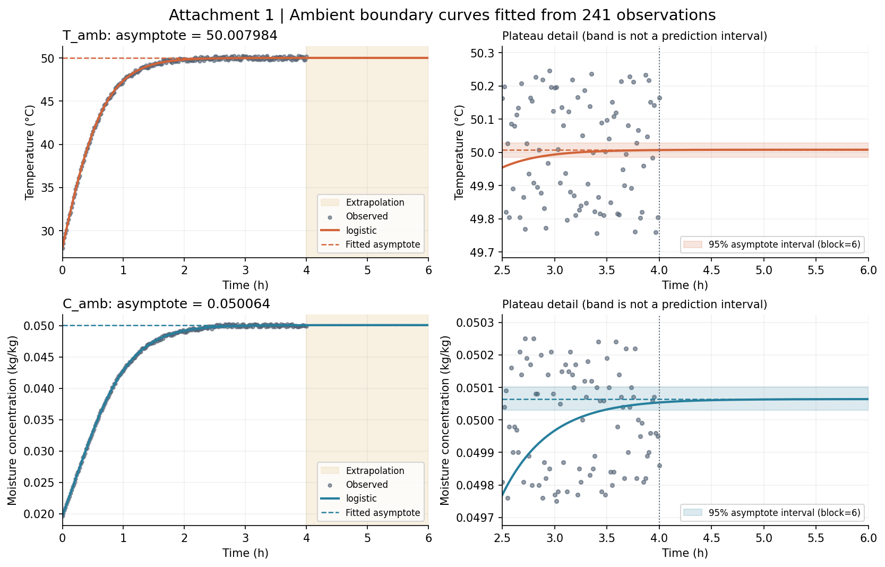
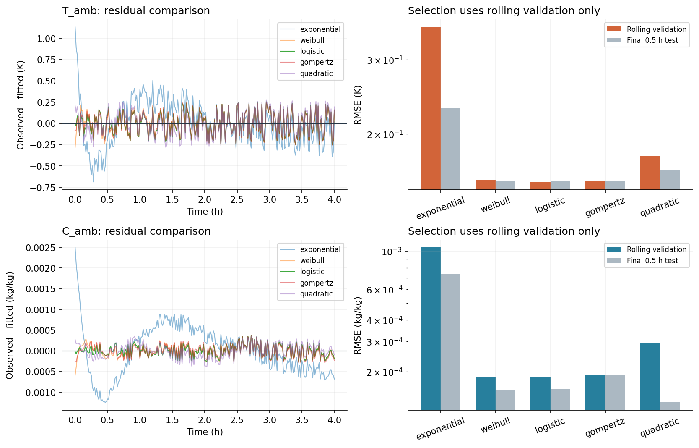

# 问题二：从附件 1 拟合烘房稳定温度与水分浓度

## 1. 结论与数据来源

本报告由 `fit_boundary.py` 实际运行生成，不把末次观测、尾段均值或经验设定值当作拟合平台。
拟合对象是环境边界 `T_amb(t)`、`C_amb(t)`，对应项目符号 $T_\infty(t)$、$C_\infty(t)$，不是药材内部的 $T(r,t)$、$C(r,t)$。
**这里的“湿度”是附件标注的水分浓度（kg/kg），不是相对湿度（%）。**

- 原件：`problem/附件/附件1.xlsx`，`Sheet1!A1:C242`。
- SHA-256：`7ef32870abeef420b89560b2530ff60dfe4255917805151d89988d0311af9dd7`。
- 共 241 行观测，时间 0–14400 s，间隔 60 s。
- 读取后不删点、不插补、不平滑原始观测；温度在读取边界转换为 K，计算时间一律 s。
- 题意依据：`problem/A题.pdf` 第 2 页问题二、第 3 页附录 1。附件 2 是半径数据，不作为温湿环境的拟合输入。
- 问题二展示的前 3 h 全部在实测区间内；2–3 天的全过程需要额外的环境外推假设。

| 拟合对象 | 所选模型 | 拟合稳定值 | 块长 6 的近似 95% 平台区间 | 全样本 RMSE | 末段测试 RMSE |
|---|---|---:|---|---:|---:|
| 烘房温度 | 归一化 Logistic | 50.00798422 °C | [49.98540105, 50.02888634] °C | 0.1366324 | 0.15477795 |
| 烘房水分浓度 | 归一化 Logistic | 0.05006422 kg/kg | [0.05002970, 0.05010119] kg/kg | 0.00014183946 | 0.00015809708 |

温度误差的数值单位为 K（与 °C 温差相同），水分浓度误差单位为 kg/kg。较多小数用于复算，不代表测量精度或长期预测精度。



## 2. 候选曲线与约束

每一列独立拟合，统一写成“**平台 − 初始差值 × 剩余比例**”。下表中的 `plateau`、`gap`、`tau_s`、`power`、`log_shape`、`curvature` 仅为本目录的拟合参数名，不改项目正式物理符号表。
所有模型均满足：初值为 `plateau-gap`，当时间趋于无穷时趋于 `plateau`，且非负 `gap` 下单调上升；波动被保留在残差中，不要求拟合线穿过每个观测点。

| 模型 | 剩余比例（`t` 为秒） | 均值模型参数数 |
|---|---|---:|
| 单指数 | `exp(-t/tau_s)` | 3 |
| 广义指数 | `exp(-(t/tau_s)**power)` | 4 |
| 归一化 Logistic | `(1+exp(log_shape))/(1+exp(log_shape+t/tau_s))` | 4 |
| 归一化 Gompertz | `(1-exp(-exp(log_shape)*exp(-t/tau_s)))/(1-exp(-exp(log_shape)))` | 4 |
| 二次指数 | `exp(-t/tau_s-curvature*(t/tau_s)**2)` | 4 |

Logistic 用 `expit` 等价实现，Gompertz 用 `expm1` 避免小量相减。广义指数 `power<1` 时起点斜率可能无界，因此它只是候选经验曲线，不解释为设备动力学。

采用 SciPy `least_squares` 的带界非线性最小二乘，多组初值求解并取最小目标值。每次拟合仅用自己的训练集极差归一化，避免时间验证泄漏。归一化平台界为 [0,5]，差值 [0,10]，时间尺度为 [采样间隔/10, 100×训练时长]；`power` 界为 [0.25,5]，`log_shape` 为 [-8,5]，`curvature` 为 [0,20]。这些是计算搜索界而非题目物性参数，未指定稳定温度或浓度；触界情况在下方明确记录。

不使用神经网络：本任务只有两条短单变量序列，需要有限极限和可解释外推。这里直接比较具有这些约束的低维曲线，不声称机器学习不能拟合。

## 3. 时间验证与模型比较

不随机打乱时间。三个扩展训练窗口分别为 0–2 h、0–2.5 h、0–3 h，各自预测紧接着的 0.5 h，合并为滚动验证 RMSE，**只按该分数选模型**。最后 3.5–4 h 不参与选择，用 0–3.5 h 重新拟合后评估末段测试误差。选型结束才用全部 0–4 h 估计最终平台。最后半小时虽提供独立于选型的误差检查，但仍不能验证 72 h 外推；本报告也展示其他候选的测试分数，不据此重新选型。

AICc 仅辅助诊断：按高斯独立误差计算，参数数包含误差方差。自相关较强时其假设不成立，不能只看 AICc 或全样本误差做决定。

### 烘房温度

| 模型 | 平台（°C 或 kg/kg） | 全样本 RMSE | 滚动验证 RMSE | 末段测试 RMSE | AICc | 残差一阶相关 | 全样本触界 |
|---|---:|---:|---:|---:|---:|---:|---|
| 单指数 | 50.15327743 | 0.2657543 | 0.35879929 | 0.23008349 | -630.569 | 0.7220 | 无 |
| 广义指数 | 50.00652613 | 0.13966966 | 0.15553389 | 0.15481111 | -938.550 | 0.0394 | 无 |
| 归一化 Logistic | 50.00798422 | 0.1366324 | 0.15366844 | 0.15477795 | -949.147 | 0.0100 | 无 |
| 归一化 Gompertz | 50.01539628 | 0.13687745 | 0.15497459 | 0.15469043 | -948.283 | 0.0128 | 无 |
| 二次指数 | 49.97061738 | 0.14725125 | 0.17690845 | 0.16351917 | -913.071 | 0.1421 | 无 |

所选模型相对第二名（归一化 Gompertz）的滚动验证 RMSE 仅降低 0.843%。这是候选集合内的数值排序，不是模型唯一正确或统计显著优胜的证明。候选平台的差异可作为模型形式敏感性的对照，不能当作另一种置信区间。

| 模型 | 2–2.5 h 验证 RMSE | 2.5–3 h 验证 RMSE | 3–3.5 h 验证 RMSE |
|---|---:|---:|---:|
| 单指数 | 0.46443658 | 0.29020985 | 0.29374767 |
| 广义指数 | 0.15182684 | 0.16315306 | 0.15133428 |
| 归一化 Logistic | 0.14372915 | 0.16528444 | 0.15121161 |
| 归一化 Gompertz | 0.15105945 | 0.15988684 | 0.15384606 |
| 二次指数 | 0.16236152 | 0.21034733 | 0.15258617 |

### 烘房水分浓度

| 模型 | 平台（°C 或 kg/kg） | 全样本 RMSE | 滚动验证 RMSE | 末段测试 RMSE | AICc | 残差一阶相关 | 全样本触界 |
|---|---:|---:|---:|---:|---:|---:|---|
| 单指数 | 0.05065273 | 0.00060913554 | 0.0010518296 | 0.00074222973 | -3560.303 | 0.9433 | 无 |
| 广义指数 | 0.05005150 | 0.00015617793 | 0.00018671109 | 0.00015529375 | -4214.241 | 0.1974 | 无 |
| 归一化 Logistic | 0.05006422 | 0.00014183946 | 0.00018500281 | 0.00015809708 | -4260.657 | 0.0668 | 无 |
| 归一化 Gompertz | 0.05010714 | 0.0001502321 | 0.00019062911 | 0.00019165664 | -4232.949 | 0.1600 | 无 |
| 二次指数 | 0.04995826 | 0.000168873 | 0.00029368921 | 0.0001327564 | -4176.572 | 0.3388 | 无 |

所选模型相对第二名（广义指数）的滚动验证 RMSE 仅降低 0.915%。这是候选集合内的数值排序，不是模型唯一正确或统计显著优胜的证明。候选平台的差异可作为模型形式敏感性的对照，不能当作另一种置信区间。

| 模型 | 2–2.5 h 验证 RMSE | 2.5–3 h 验证 RMSE | 3–3.5 h 验证 RMSE |
|---|---:|---:|---:|
| 单指数 | 0.0013164504 | 0.00090808378 | 0.00087257034 |
| 广义指数 | 0.00017407936 | 0.00020801508 | 0.00017609429 |
| 归一化 Logistic | 0.00013890637 | 0.00023140672 | 0.00017272542 |
| 归一化 Gompertz | 0.00017845251 | 0.00018965991 | 0.00020298325 |
| 二次指数 | 0.00027468354 | 0.00038193613 | 0.00019347818 |



## 4. 最终参数、稳定时间与数值核对

以下参数为全样本拟合值：温度平台、差值使用 K，浓度使用 kg/kg，时间尺度使用 s。调用时保留内部完整浮点数；本表保留 12 位有效数字供复算。

| 对象 | 参数 | 数值 |
|---|---|---:|
| `T_amb` | `plateau` | 323.157984221 |
| `T_amb` | `gap` | 22.0000569545 |
| `T_amb` | `tau_s` | 1368.3231237 |
| `T_amb` | `log_shape` | 0.290460163475 |
| `C_amb` | `plateau` | 0.0500642244884 |
| `C_amb` | `gap` | 0.0304146223163 |
| `C_amb` | `tau_s` | 1613.73918406 |
| `C_amb` | `log_shape` | -0.452266387861 |

本次两条曲线均为 Logistic。将参数代入，下面以 °C、kg/kg 展示，其中 `t` 的单位仍为秒；进入 PDE 前温度须加 273.15：

$$
T_\infty(t)\;[{}^\circ\mathrm{C}] = 50.0079842211 - \frac{51.4150704075}{1 + 1.33704260466\exp(t/1368.3231237)}.
$$

$$
C_\infty(t) = 0.0500642244884 - \frac{0.0497639389383}{1 + 0.636184675275\exp(t/1613.73918406)}.
$$


“稳定”没有唯一时刻。以下采用自定的相对判据：剩余平台差不超过拟合初始差值的 1% 或 0.1%。这不是题目给定的阶段切换条件；全过程建议使用连续曲线，不在这个时刻突然切换常数。

| 对象 | 1% 判据时刻 / h | 0.1% 判据时刻 / h | 初始拟合值 | 最后观测值 | 最后 1 h 均值 |
|---|---:|---:|---:|---:|---:|
| `T_amb` | 1.961000 | 2.837656 | 28.00792727 | 50.16500000 | 49.99893443 |
| `C_amb` | 2.485012 | 3.519645 | 0.01964960 | 0.04986000 | 0.04998754 |

上表温度绝对值以 °C 展示，浓度以 kg/kg 展示。末次值、尾均值只作对照，不进入平台约束。

| 时间 / h | 拟合烘房温度 / °C | 拟合水分浓度 / (kg/kg) | 证据类型 |
|---|---:|---:|---|
| 0 | 28.00792727 | 0.01964960 | 实测区间内的拟合 |
| 0.5 | 41.41379042 | 0.03314294 | 实测区间内的拟合 |
| 1 | 47.38042170 | 0.04287439 | 实测区间内的拟合 |
| 1.5 | 49.27550041 | 0.04745406 | 实测区间内的拟合 |
| 2 | 49.80935484 | 0.04917740 | 实测区间内的拟合 |
| 2.5 | 49.95453177 | 0.04977002 | 实测区间内的拟合 |
| 3 | 49.99362956 | 0.04996741 | 实测区间内的拟合 |
| 4 | 50.00695028 | 0.05005380 | 实测区间内的拟合 |
| 6 | 50.00797886 | 0.05006410 | 无实测验证的外推 |
| 24 | 50.00798422 | 0.05006422 | 无实测验证的外推 |
| 48 | 50.00798422 | 0.05006422 | 无实测验证的外推 |
| 72 | 50.00798422 | 0.05006422 | 无实测验证的外推 |

## 5. 不确定性与稳健性

随机基准种子为 20260912，每个对象、每种块长进行 300 次残差重采样。在固定拟合时刻上循环抽取连续残差块，叠加到拟合曲线上重新拟合；重采样是统计诊断，不作为新观测。取平台分布的 2.5% 与 97.5% 分位数。块长 1（独立残差对照）、6、12 个采样点是本分析的敏感性设置，不是题目参数。

**这些是给定模型及残差平稳假设下的近似平台区间，不是未来单点预测区间，也不包含模型选择、测量系统偏差和 4 h 后控制工况变化。**若残差有系统形状或自相关，重采样区间不能修复模型误设。

| 对象 | 块长 / 点 | 近似 95% 平台区间（°C 或 kg/kg） | 成功次数 | 触界次数 | 实际随机种子 |
|---|---:|---|---:|---:|---:|
| `T_amb` | 1 | [49.98277803, 50.02829372] | 300/300 | 0 | 20260913 |
| `T_amb` | 6 | [49.98540105, 50.02888634] | 300/300 | 0 | 20260918 |
| `T_amb` | 12 | [49.98996278, 50.02878016] | 300/300 | 0 | 20260924 |
| `C_amb` | 1 | [0.05003414, 0.05009352] | 300/300 | 0 | 20261013 |
| `C_amb` | 6 | [0.05002970, 0.05010119] | 300/300 | 0 | 20261018 |
| `C_amb` | 12 | [0.05002778, 0.05010714] | 300/300 | 0 | 20261024 |

### 截断观测时长的敏感性

固定最终所选模型，仅改变用于估计的观测时长；此表不是第二次模型选择。

| 训练到 / h | 温度平台 / °C | 浓度平台 / (kg/kg) |
|---|---:|---:|
| 2 | 50.01228343 | 0.05001239 |
| 2.5 | 49.98882334 | 0.05002329 |
| 3 | 50.01512967 | 0.05011771 |
| 3.5 | 50.00646839 | 0.05009319 |
| 4 | 50.00798422 | 0.05006422 |

### 稳健损失对照

在同一归一化尺度用 `soft_l1` 重拟合，`f_scale=0.01` 为训练极差的 1%，不删除大残差观测，也不替代已选的普通最小二乘主结果。

| 对象 | 普通最小二乘平台 | soft_l1 平台 | 两者之差 |
|---|---:|---:|---:|
| `T_amb` | 50.00798422 | 50.00691000 | -0.0010742203 |
| `C_amb` | 0.05006422 | 0.05006167 | -2.5538981e-06 |

### 求解告警

- 候选拟合、时间验证与截断拟合未发现失败初值或参数触界；bootstrap 成功与触界次数见表。

## 6. 问题二接入方式与范围

- 推荐在全过程边界中使用 `FittedBoundary.ambient(time_s)` 的连续输出，温度返回 K、水分浓度返回 kg/kg；平台值可用于描述长期恒温环境，但不应从 t=0 就替换为常数。
- 初始环境读数视为含噪观测，因此初值也参与拟合，未强制穿过附件首点。题目给定的药材初始温度与干基含水率不因此改变。
- 4 h 以后继续趋于同一平台，是“控制工况保持不变”的外推假设，不是附件证实的事实；请勿把图中的 6–72 h 曲线称为实测。
- 当前 `src/common/boundary.py` 使用观测间线性插值并在末尾保持最后读数。本任务没有替换该模块、重跑 PDE、更新 result2.xlsx，故不声称药材场或最终干燥时长已经改变。
- 按用户限定，所有算法、报告和图均在 `nihe/`；未修改 `docs/NOTATION.md`、`docs/DECISIONS.md` 或任务看板。正式接入前需由相应 Owner 同步边界拟合决策与参数记号。

## 7. 复现

```bash
conda run -n tf2 python -B nihe/fit_boundary.py --bootstrap 300 --seed 20260912
conda run -n tf2 python -B -m unittest discover -s nihe -p 'test_*.py' -v
```

本次库版本：NumPy 1.26.4，SciPy 1.13.1，openpyxl 3.1.5。
图件同时输出 PNG（Markdown 预览）与 PDF（矢量版）。图和表中的数值均来自本次运行。

算法依据：SciPy 官方 `scipy.optimize.least_squares` 文档（有界最小二乘、稳健损失）；Forecasting: Principles and Practice 第 3 版 §5.10（按时间滚动验证）。这些只用于算法核对，不提供题目参数。具体曲线、区间和验证结果以本目录代码为准。
